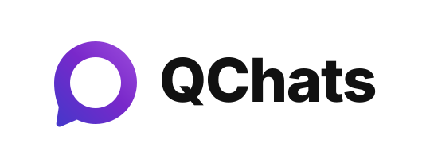

<h1 align="center">
  
</h1>

<h3 align="center">Private messaging. Connected without borders.</h3>

<p align="center">
  <b>QChats</b> is an open, secure, offline-first, peer-to-peer and zero-trust messaging platform.
</p>

---

## Quickstart: Run QChats!

### CLI (Command Line Interface)

You can run the **QChats CLI** directly on Windows or Linux / WSL:

#### On Windows (PowerShell or Command Prompt)
```powershell
# Interactive terminal messaging client
.\qchats.bat mini

# Start full background node / protocol daemon
.\qchats.bat daemon

# Inspect node status and connected P2P peers
.\qchats.bat info

# Display QChats banner & quote of the day
.\qchats.bat banner

# View all commands and flags
.\qchats.bat --help
```

#### On Linux / WSL / macOS
```bash
# Build the binary
go build -o qchats ./go/cmd/berty

# Run commands
./qchats mini
./qchats daemon
./qchats info
./qchats banner
```

### Web & Desktop Client (Offline Mesh App)

Run the modern offline-first web client with the custom OKLCH theme and emergency beacon tools:
```powershell
# Windows 1-click launcher
.\web.bat

# Or run directly via npm
cd web
npm run dev
```
Open [http://localhost:5173](http://localhost:5173) in your browser.

---

### Features

- **End-to-End Encrypted & Private**:
  - Direct peer-to-peer communication with zero metadata leakage.
  - No phone number, email address, or identity verification required.
  - Cryptographically secure by default.
- **Censorship-Resilient & Offline-First**:
  - Operates serverless across local networks and direct device meshes.
  - Supports BLE (Bluetooth Low Energy) and mDNS local network discovery without internet access.
- **Multi-Platform**:
  - Terminal client (`qchats mini`)
  - Protocol daemon and API server (`qchats daemon`)
  - Cross-platform mobile (React Native & Expo)
  - Desktop / Web client

---

## Project Structure

- `go/`: Core Go implementation and daemon.
  - `go/cmd/berty` / `go/cmd/qchats`: Main **QChats CLI** commands (`mini`, `daemon`, `info`, `banner`, etc.).
  - `go/internal/initutil`: Node and service manager, keystore, and datastore management.
  - `go/pkg/`: Protocol wrappers, banner generator, and messenger services.
- `berty-bridge-expo/`: Modern Expo & React Native mobile client.
- `js/`: Web and desktop client packages (`js/web`, `js/packages`).
- `assets/`: Vector logos and brand assets (`qchats-logo.svg`, `qchats-icon.svg`).

---

## Technology Stack & Architecture

QChats is powered by open peer-to-peer technologies:
- **Wesh Protocol**: Decentralized group messaging and cryptographic ratchet.
- **libp2p**: Universal peer-to-peer networking, NAT traversal, and relaying.
- **IPFS & OrbitDB**: Distributed content-addressed datastores and append-only logs.
- **Go**: High-performance core networking and daemon backend.
- **React Native & Expo**: Cross-platform mobile applications.

---

## Licensing & Attribution

Portions of this codebase originate from the open-source Berty project, developed by [Berty Technologies](https://berty.tech).
Licensed under either the [Apache License, Version 2.0](LICENSE-APACHE) or the [MIT License](LICENSE-MIT), at your option. See [`COPYRIGHT`](COPYRIGHT) for details.
